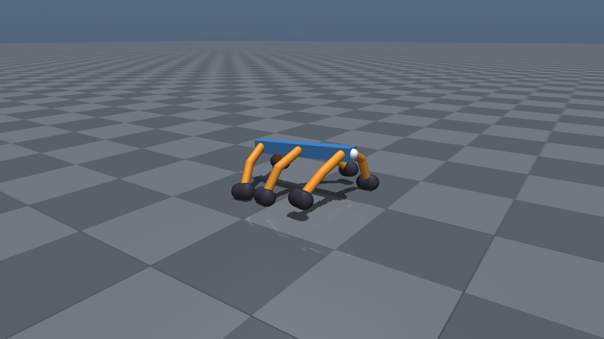
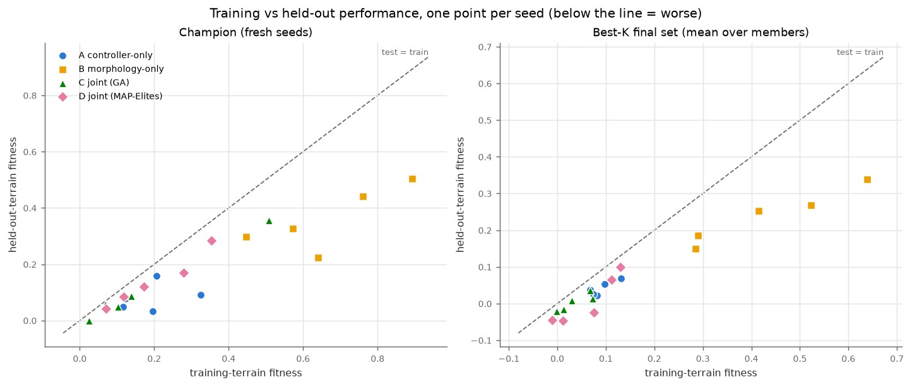
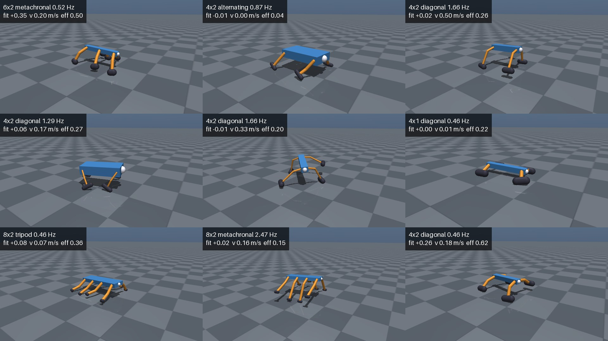
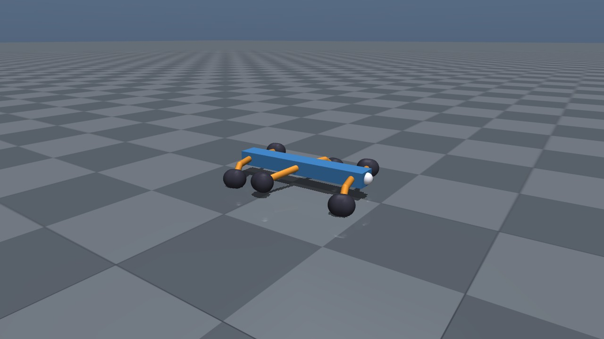
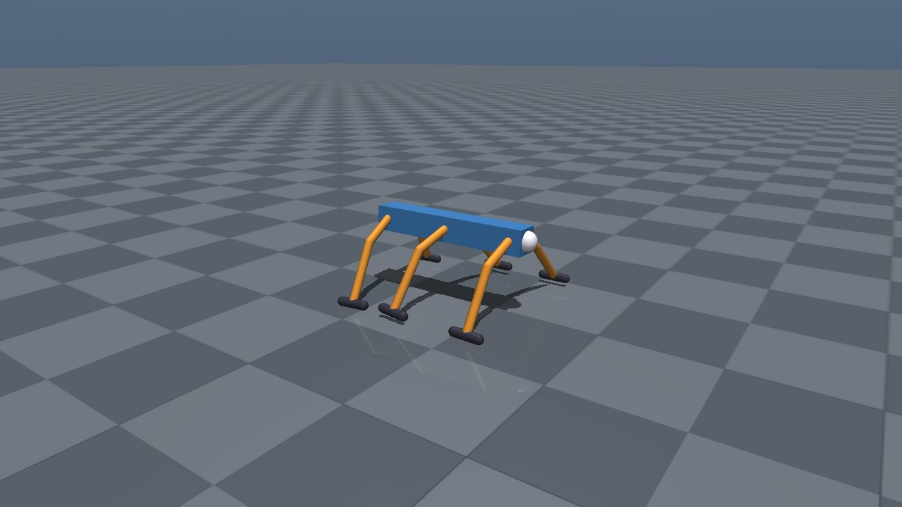
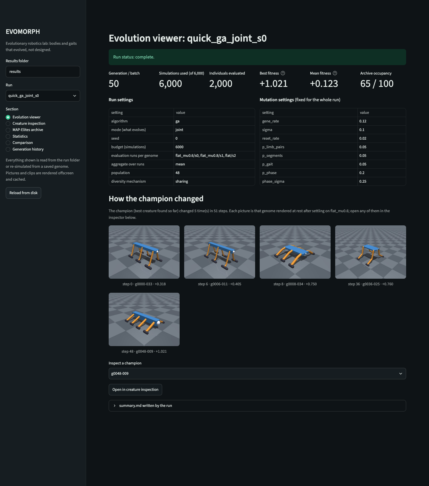
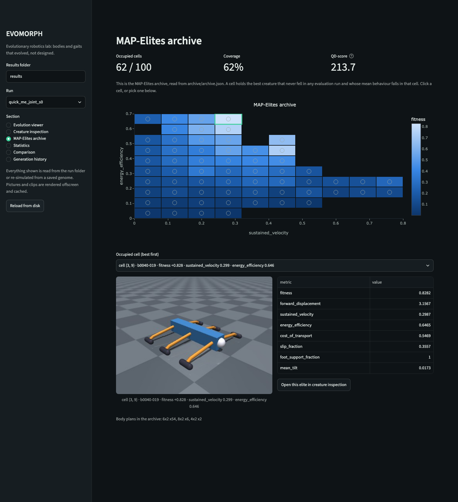
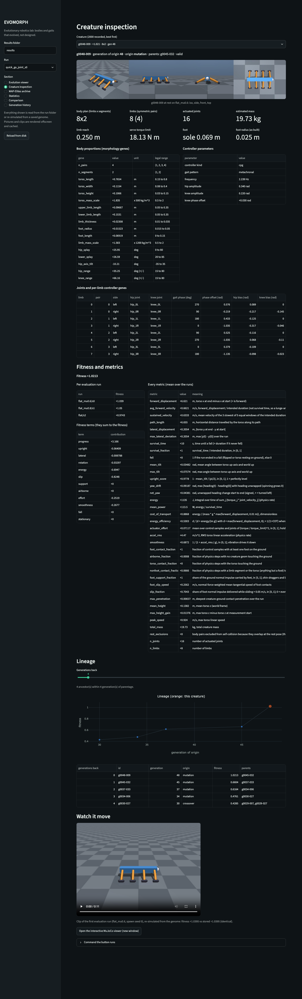
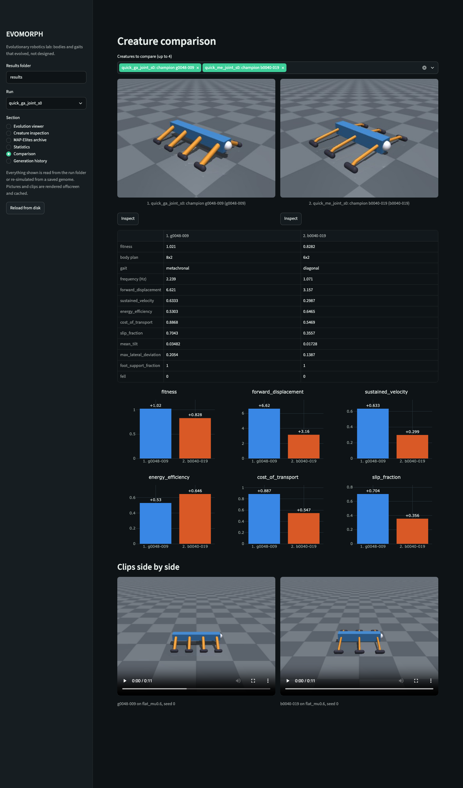

# EVOMORPH

**A software-only evolutionary robotics lab.** Creatures with evolved bodies
(2 to 8 legs, one or two segments per leg, evolved proportions, masses and
joint ranges) and evolved central-pattern-generator gaits learn to walk in
MuJoCo physics, by a genetic algorithm or by MAP-Elites, across slopes,
rough ground, obstacles and slippery patches. Nothing is animated: every
picture is a saved genome re-simulated offscreen.

It was built to answer one question, and to be able to answer it with "no":

> **Does evolving morphology and controller together give more robust and more
> behaviourally diverse locomotion than evolving a controller for a fixed body?**

**Status.** The engine, terrains, comparison experiment and dashboard are
built and tested, and the full comparison experiment (4 conditions x 5 seeds)
has finished. **Its answer is "not shown":** joint evolution did not beat the
alternatives on robustness or behavioural diversity at this budget, and
morphology-only evolution (which starts from a hand-designed gait) had the best
held-out champions. See [Research results](#research-results) and
[docs/RESULTS.md](docs/RESULTS.md).

[](docs/media/results/evolution.mp4)

*The champion of one MAP-Elites run (condition D, seed 2) at each generation
where it changed, from the comparison experiment; 13 s, re-simulated offscreen
from the saved genomes. Click for the clip.*

## Contents

- [Install](#install)
- [Commands](#commands)
- [Architecture](#architecture)
- [The fitness function](#the-fitness-function)
- [Research results](#research-results)
- [Dashboard](#dashboard)
- [Limits and known issues](#limits-and-known-issues)
- [Reproduce everything](#reproduce-everything)

## Install

Needs Python 3.12 (3.11 also works) and [uv](https://docs.astral.sh/uv/)
(`curl -LsSf https://astral.sh/uv/install.sh | sh` or `brew install uv`).
Everything runs on the CPU; no GPU is used.

```bash
git clone https://github.com/TeleVision05/evomorph.git
cd evomorph
uv venv --python 3.12
uv pip install --python .venv/bin/python -r requirements-lock.txt -e ".[dev,dashboard]"
.venv/bin/pre-commit install        # optional: ruff + size checks on every commit
.venv/bin/python -m pytest -q       # fast suite
```

`requirements-lock.txt` pins the exact versions the results were made with
(macOS arm64, Python 3.12.13, MuJoCo 4.0.1). Runs are bit-identical across
processes and worker counts, but only within one MuJoCo version.

On a Linux machine without a display, set `MUJOCO_GL=egl` or `MUJOCO_GL=osmesa`
for offscreen rendering (CI uses OSMesa). The six tests that render are skipped,
and counted as skipped, when no OpenGL context can be made.

## Commands

Everything is `.venv/bin/python -m evomorph <command>`; `--help` on any command
lists its options. Runs write to `results/` (not committed).

| command | what it does |
|---|---|
| `random --n 5 --seed 0 --out DIR` | write seeded random genomes as JSON |
| `inspect --genome G.json --png out.png` | describe and validate a genome, render its rest pose (`--reference hexapod\|quadruped`, `--save`, `--view` for the interactive viewer) |
| `evaluate --genome G.json --video out.mp4` | simulate a genome: metrics table, fitness terms, optional video (`--friction`, `--config`) |
| `evolve --config configs/quick.yaml` | one search run; `--algorithm map_elites`, `--mode controller\|morphology`, `--no-diversity`, `--budget`, `--seed`, `--workers` |
| `experiment --type comparison` | the A-D comparison, resumable (`--quick` for a smoke test, `--seeds`, `--budget`, `--workers`) |
| `analyze --run DIR` | plots, statistics and `summary.md` for a run or an experiment folder |
| `robustness --genome G.json --suite test` | score one genome across a terrain suite (`--list` shows the suites) |

```bash
.venv/bin/python -m evomorph evolve --config configs/quick.yaml --name demo   # roughly 6-12 min
.venv/bin/python -m evomorph analyze --run results/demo
.venv/bin/streamlit run evomorph/visualization/dashboard.py
```

The interactive viewer (`inspect --view`) uses the blocking `mujoco.viewer.launch`,
which runs under the plain venv python on macOS.

## Architecture

```
evomorph/
  morphology/    genome (GENE_BOUNDS: every gene is 'morphology' or 'controller'),
                 procedural MJCF generator, validator
  controllers/   Controller interface + registry; the CPG controller
  simulation/    terrain (flat, slope, uneven, friction patches, random), suites
                 (train / held-out test), evaluator (physics-rate metrics,
                 glitch guards), metrics, fitness
  evolution/     GA, MAP-Elites, operators, selection and diversity, archive,
                 run directories, process pool (max 6 workers)
  experiments/   the A-D comparison: conditions, design, post-hoc re-scoring,
                 measures, results table, terrain robustness
  analysis/      statistics (bootstrap CIs, Mann-Whitney, A12, Holm), plots
                 (Agg backend), offscreen gallery, summaries
  visualization/ offscreen renderer, interactive viewer, Streamlit dashboard
  commands/      one CLI module per command, discovered automatically
configs/         quick.yaml, research.yaml, comparison.yaml
scripts/         rendering, plotting, budget planning, validation helpers
```

How a creature is made and scored:

1. A **genome** holds body genes (limb pairs 1-4, segments 1-2, torso size and
   mass, limb lengths, thickness, foot size, splay, hip-axis tilt, joint
   ranges) and controller genes (gait pattern, frequency, hip and knee
   amplitudes, knee phase offset, per-limb phase offsets and posture biases).
2. The **generator** writes an MJCF model with a free root joint, symmetric
   limbs, hinge joints, position servos, contact feet and mass from density.
   The validator compiles it before anything is simulated; an invalid genome
   is scored, never crashed on.
3. The **CPG** drives each joint with `A sin(2 pi f t + phase)`, the phases
   coming from the gait pattern (alternating, diagonal, tripod, metachronal)
   for whatever limb count the body has, plus evolved per-limb offsets.
4. The **evaluator** settles the creature for 1 s, then runs 10 s at a 2 ms
   physics step. Energy, contacts, slip and airborne time are integrated at
   every physics step; guards reject non-finite states, runaway speed or spin,
   launches and tunnelling.
5. **Evolution** scores every genome on several runs, not one: the quick config
   uses 3 flat-ground runs per genome, the comparison experiment uses all 11
   training environments (11 simulations per genome). Budgets are counted in
   simulations (genomes x runs).

Design documents: [docs/EVOLUTION.md](docs/EVOLUTION.md) (engine),
[docs/TERRAINS.md](docs/TERRAINS.md) (terrains and suites),
[docs/EXPERIMENT.md](docs/EXPERIMENT.md) (the comparison design),
[docs/DASHBOARD.md](docs/DASHBOARD.md),
and the original brief [docs/SPEC.md](docs/SPEC.md).

## The fitness function

```
fitness = (sustained_velocity / 0.2 m/s)
          x upright x lateral x rotation x energy x slip x support x airborne x effort x smoothness
          - 1.0 x fell - 0.2 x stationary
```

| factor | 1 when | falls toward 0 when |
|---|---|---|
| upright | torso level | the body leans or rolls |
| lateral | the path is straight | it crabs sideways or wanders |
| rotation | heading holds | it spins or circles |
| energy | cost of transport is low | it thrashes |
| slip | feet grip | feet slide while loaded (skating) |
| support | only feet touch the ground | shins, knees or belly drag |
| airborne | at most 5% of the time in the air | it hops, bounds or launches |
| effort | servos are not saturated | it strains |
| smoothness | accelerations are gentle | it vibrates or slams |

Why it is built this way:

- **Multiplicative, not additive.** An earlier additive version capped each
  penalty, so any creature faster than about 0.7 m/s won however badly it
  moved. Here every flaw scales progress down: halving a factor halves the
  score at any speed, so speed cannot buy back a bad gait.
- **Sustained velocity, not displacement.** A creature that lunges and stops
  scores its steady speed, not its lunge.
- **Backward motion and falling are penalties, bounded.** Backward progress is
  not softened by the quality factors and is capped at -2, so every valid score
  is at least -3.2 and an invalid genome (-20) always ranks last.
- **Metrics are kept separately from the score.** 36 raw metrics are stored
  for every run, and the score's terms sum exactly to the fitness, so any
  champion can be audited term by term.

The scales were calibrated on a 300-genome random sweep plus two hand-built
reference creatures, never on evolved champions (`evomorph/simulation/fitness.py`,
`configs/*.yaml`).

## Research results

The full comparison (conditions A controller-only, B morphology-only, C joint
GA, D joint MAP-Elites; 5 seeds each; 1441 simulations per run; trained on 11
terrains, tested on 11 held-out terrains) finished on 2026-11-13.
Everything is in [docs/RESULTS.md](docs/RESULTS.md); the committed tables,
champion genomes and plots are in [docs/results/comparison/](docs/results/comparison/).



*Each point is one seed's champion, re-scored on fresh seeds. Below the dashed
line is worse on unseen terrain.*

| median over 5 seeds | A controller | B morphology | C joint GA | D joint MAP-Elites |
|---|---|---|---|---|
| champion fitness, held-out terrain | 0.078 | **0.327** | 0.058 | 0.120 |
| behavioural diversity, held-out (0-1) | 0.170 | 0.111 | 0.157 | 0.158 |
| body plans in the final population (set by the selection rule, not a result) | 1 | 8 | 8 | 4 |

What this shows and does not show:

- **The hypothesis (C more robust and more diverse than A and B) is not
  shown.** No primary comparison is significant after Holm correction; C is
  behind B on robustness (A12 0.12, raw p 0.056, Holm p 0.33).
- **It is not a result about the idea, but about a small budget.** 131 genomes
  (6 to 9 generations) per run is far too little: most champions in A, C and
  D are worse on held-out terrain than the hand-designed quadruped (0.173 on
  the champions' seeds). B is a strong baseline with a head start: it keeps
  the hand-designed gait, and its generation-0 best is 0.08, 0.62, 0.60, 0.79
  and 0.32 over seeds 0-4. For 4 of 5 seeds that is above A's and C's
  generation-0 bests (at most 0.20) and above most of their final bests, so
  much of B's lead probably exists before any search (an inference: no control
  such as A seeded with the reference gait was run).
- **Five seeds** can only call near-complete separation significant.
- **Exploit check:** 4 of the 20 champions (B0, B4, C2, C4) spend over 20% of
  the time airborne and several skate; none tunnels, flies or loses foot
  support. Dropping the flagged ones keeps B first and D second but swaps A and
  C (0.078 vs 0.086, within noise), and the primary conclusion is unchanged.
  All 20 champions slide while loaded. The held-out suite is dominated by
  slope and roughness and does not isolate grip: ice (mu 0.2) costs the
  champions about a third compared with mu 0.7 (0.231 vs 0.369, post hoc, uncorrected) but
  is not below the held-out average (0.173)
  ([docs/RESULTS.md](docs/RESULTS.md)).

Earlier, smaller results:

| result | scale | where | what it shows |
|---|---|---|---|
| **Quick runs** (GA, MAP-Elites, GA without diversity) | 1 seed each, 6000 simulations, flat ground | [docs/EVOLUTION.md](docs/EVOLUTION.md) | The engine works: the GA's best fitness rose from +0.32 to +1.02 (about 0.65 m/s) and MAP-Elites filled 62% of its archive. One seed each, so no algorithm ranking. |
| **Quick comparison** | 2 seeds x 4 conditions, 660 simulations per run | [docs/EXPERIMENT.md](docs/EXPERIMENT.md) | A smoke test of the pipeline. |
| **Terrain suites and reference creatures** | 300 random genomes plus two hand-built references | [docs/TERRAINS.md](docs/TERRAINS.md) | Calibration of the fitness and the terrain suites. |

Media (offscreen renders of the real genomes, described in
[docs/media/results/NOTES.md](docs/media/results/NOTES.md)):

| MAP-Elites elites | Best morphology-only champion | Best joint champion |
|---|---|---|
|  |  |  |

To regenerate the raw run data (23 MB, not committed): `python -m evomorph
experiment --type comparison` (see [Reproduce everything](#reproduce-everything)).


## Dashboard

```bash
.venv/bin/streamlit run evomorph/visualization/dashboard.py
```

Six sections over any run directory, including runs still in progress:
evolution viewer, creature inspection (with an on-demand clip and a button
that opens the MuJoCo viewer), the MAP-Elites archive as a clickable heat map,
statistics, side-by-side comparison and generation history. Every image is a
saved genome rendered offscreen in a child process; every clip is a
re-simulation whose fitness is shown next to the stored one.
Details: [docs/DASHBOARD.md](docs/DASHBOARD.md).

| Evolution viewer | MAP-Elites archive |
|---|---|
|  |  |
| **Creature inspection** | **Comparison** |
|  |  |

The screenshots show two quick single-seed runs (`configs/quick.yaml`,
6000 simulations each), not the comparison experiment.

## Limits and known issues

- **The research question is open.** The full comparison says "not shown", but
  with 131 genomes per run and 5 seeds it could not have shown a modest effect;
  the longer overnight run recommended in
  [docs/EXPERIMENT.md](docs/EXPERIMENT.md) has not been made.
- **B had a head start.** Morphology-only evolution keeps the hand-designed
  gait, so its lead at this budget does not say that body evolution beats
  joint evolution ([docs/RESULTS.md](docs/RESULTS.md)).
- **Fast creatures skate.** The fitness charges foot slip, but the fastest
  evolved gaits still slide while loaded (docs/EVOLUTION.md, docs/EXPERIMENT.md).
- **Reproducibility is per platform.** Runs are bit-identical across processes
  and worker counts within one MuJoCo version on one CPU architecture; across
  architectures the last bits can differ (a re-simulated fitness differed by
  3.4e-15 between macOS arm64 and Linux x86-64), so the dashboard and tests
  compare re-simulated fitness within a stated tolerance
  ([docs/DASHBOARD.md](docs/DASHBOARD.md)).
- **CPU only, at most 6 worker processes.**
- Further limits: [docs/EXPERIMENT.md](docs/EXPERIMENT.md#limitations),
  [docs/TERRAINS.md](docs/TERRAINS.md).


## Reproduce everything

```bash
.venv/bin/python -m pytest -q                                               # tests
.venv/bin/python -m evomorph evolve --config configs/quick.yaml             # quick GA run
.venv/bin/python -m evomorph evolve --config configs/quick.yaml --algorithm map_elites
.venv/bin/python -m evomorph experiment --type comparison --quick           # smoke-sized comparison (about 26 min measured)
.venv/bin/python -m evomorph experiment --type comparison                   # the full design (about 100 min of run time here, 3 sessions); re-run the same command to resume
.venv/bin/python -m evomorph analyze --run results/experiments/comparison
```

The full comparison is resumable: finished runs are skipped, and a run
interrupted mid-search is set aside under `incomplete/` and redone.


## License

MIT, copyright 2026 Tarun Vadapalli. See [LICENSE](LICENSE).
