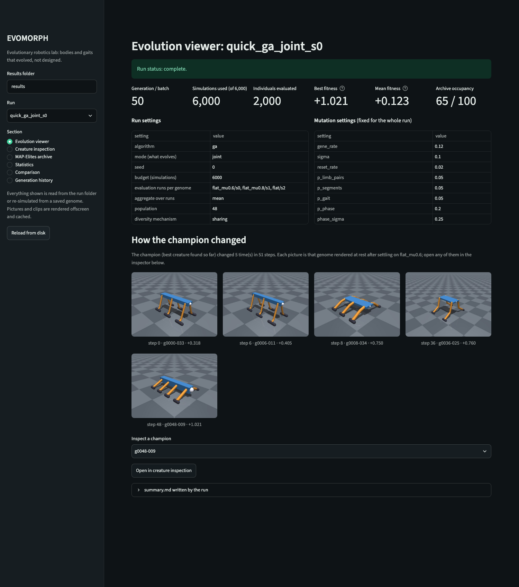

# Research dashboard

A Streamlit dashboard for watching and inspecting evolution runs (brief section 10).
Everything on it is read from a run directory written by `python -m evomorph evolve`,
or re-simulated from a genome saved there. Nothing is invented or animated for show:
every picture is a real genome rendered offscreen in MuJoCo, and every clip is a real
re-simulation, with its fitness checked against the stored number.



## Start it

```sh
uv pip install -e ".[dashboard]"          # or: pip install -e ".[dashboard]"
streamlit run evomorph/visualization/dashboard.py
streamlit run evomorph/visualization/dashboard.py -- --results path/to/results
```

Run it from the repository root. It looks for runs under `results/` (change the folder in
the sidebar, with `--results`, or with `$EVOMORPH_RESULTS`). Run folders inside experiment
folders are found too, up to three levels deep (`results/<experiment>/<condition>/<run>`).

A page can be opened on a given run and section with query parameters, for example
`http://localhost:8501/?run=quick_me_joint_s0&section=archive`. Section names:
`evolution`, `creature`, `archive`, `stats`, `compare`, `history`.

The `dashboard` extra installs streamlit and plotly. It was developed and tested with
streamlit 1.67.0, plotly 7.1.0 and MuJoCo 4.0.1 on Python 3.12.

## Sections

| Section | What it shows | Where the numbers come from |
|---|---|---|
| A. Evolution viewer | latest generation, simulations used of the budget, individuals evaluated, best and mean fitness, archive occupancy, run and mutation settings, and a strip of rendered champions, one per change of champion | `metrics.csv` (last row), `config.yaml`, `genomes/champion_gen_NNNN.json` |
| B. Creature inspection | any recorded individual: 4-view render, limb count, joints, body proportions, controller parameters, per-limb phases and biases, fitness per evaluation run, fitness terms, every metric, parents, generation and origin, lineage back through its parents (4 generations by default, up to 60 with the slider: crossover can double the ancestors per generation), a rendered clip on demand, and a button that opens the interactive MuJoCo viewer | the individual's record in `generations/gen_NNNN.json` |
| C. MAP-Elites archive | the 2-D archive as a heat map (fitness per cell); clicking a cell, or picking it below, shows that elite and can open it in the inspector | `archive/archive.json`, or rebuilt from the generation files while the run is going |
| D. Statistics | fitness of the current set (best, mean, median, p10-p90), fitness distribution per step, gene-distance diversity, body plans per step, successful and fallen creatures, archive occupancy, energy efficiency, average displacement, QD-score, distinct body plans | `metrics.csv` and the generation files |
| E. Comparison | 2-4 creatures side by side: rendered bodies, a metric table, one small bar chart per metric, and their clips side by side once rendered; picks can come from different runs (every run's champion is offered) | the records of each creature |
| F. Generation history | every step: the champion after it, the best creature evaluated in it, and a table of everyone recorded in it | the generation files |

The horizontal axis of the statistics defaults to **simulations used**, the budget unit,
so runs with different population sizes are compared at equal cost.

### Definitions

| Term | Meaning |
|---|---|
| champion | the best valid creature found so far (the engine's `champion_id`); it only changes when something better appears |
| current set | what `metrics.csv` summarises: the GA population, or the MAP-Elites archive elites |
| evaluated in a step | the GA's new children of that generation, or one MAP-Elites batch; used for the per-step plots so both algorithms are summarised the same way |
| successful | valid, never fell in any evaluation run, and moved at least 1 m forward on average. 1 m is the threshold the core's random sweep reported against (7% of 300 random genomes reached it). It is only used for reporting, never by selection |
| archive (GA run) | the GA keeps a passive archive of everything it evaluated, binned like MAP-Elites, so the two algorithms are compared on the same terms |
| QD-score | sum over filled cells of fitness + offset, where the offset (3.2 with the default fitness) is the magnitude of the lowest valid fitness |

## Run states

| Situation | What you see |
|---|---|
| results folder missing | "There is no results folder at ..." with the command that starts a run |
| results folder empty | "No runs found in ..." |
| run in progress (no `summary.md` yet) | status "in progress"; every section works on what has been written so far; the archive is rebuilt from the generation files |
| run not finished and untouched for 30 min | status "not finished; last written ... ago, so it may have stopped" |
| newest generation file or `metrics.csv` line half written | skipped, with a note that the run may be writing it right now |
| `config.yaml` missing or unreadable | "The settings file of '...' (config.yaml) is damaged and cannot be read." Other runs still open from the sidebar |
| an older generation file damaged | "The file for generation N of '...' is damaged and cannot be read." |

Raw error text is never the message. If something unexpected fails to parse, the page says
so in plain words and keeps the technical detail in a collapsed "Technical details" box.

The archive rebuild replays every evaluated record in order with the engine's insertion
rules (valid, never fell in any run, strictly better than the incumbent). On both fixture
runs it gives exactly the saved archive (`tests/test_dashboard_data.py::
test_rebuilt_archive_matches_saved_archive`).

## Rendering and caching

* **Offscreen only.** Pictures and clips are made by `evomorph.visualization.dashboard_render`
  in a child process with `mujoco.Renderer`; no window opens. A separate process keeps a
  MuJoCo or OpenGL failure away from the web server.
* **Cached on disk** under `<results>/.dashboard_cache/` (or `$EVOMORPH_DASHBOARD_CACHE`),
  never inside a run folder, so the dashboard does not change any run. The key covers the
  genes (`genome_hash`), environment, spawn seed, sim config, fitness config (clips only),
  render kind and a render version. Delete the folder to clear it.
* **Pictures** show the creature at rest after settling on the run's first evaluation
  environment (spawn seed 0, as `render_views` does).
* **Clips** re-simulate the first evaluation run (its environment and spawn seed, the run's
  sim and fitness config) and record it at 480x360. The inspector prints the re-simulated
  fitness next to the stored one; on the fixture runs and both quick runs below they are
  identical (`tests/test_dashboard_data.py::test_clip_is_a_real_resimulation`).
* **Clips play in real time.** The evaluator keeps every `round(control_rate / fps)`-th
  control step as a frame, so asking for 30 fps at the 50 Hz control rate really captures
  25 frames per simulated second. The dashboard writes its clips at that true rate (25 fps),
  so 11 s of simulation is an 11 s clip; a test checks the length. Clips written elsewhere
  at the requested 30 fps play 1.2x fast: every mp4 under `docs/media/` measured 275 frames
  at 30 fps = 9.17 s for 11 s of simulation (2026-11-13). That code is outside the
  dashboard and was not changed.
* **Data** is cached in memory per run and keyed by the files' sizes and modification
  times, so an in-progress run refreshes on the next interaction while a finished run is
  read once. "Reload from disk" in the sidebar clears every cache.
* The champion strip draws at most 16 evenly spaced changes of champion (always the first
  and the latest) to keep long runs quick; the generation history shows every step.

### Interactive viewer

The inspector's "Open the interactive MuJoCo viewer" button starts
`python -m evomorph inspect --genome <file> --view` with the run's config and first
evaluation environment, as a separate process in its own session. The exact command is
shown under the button. This is the only part of the dashboard that opens a window, and
only when the button is pressed. It was implemented and its command tested
(`test_viewer_command_is_built_but_never_launched`, with `Popen` replaced), but it has
never been pressed while developing: UNVERIFIED that the window opens from the dashboard.

## Tests

```sh
.venv/bin/python -m pytest -q tests/test_dashboard_data.py tests/test_dashboard_app.py
```

* `tests/test_dashboard_app.py` runs the app headless with Streamlit's `AppTest`: every
  section on both fixture runs, picking a creature, picking an archive cell and opening it
  in the inspector, browsing the history, comparing three creatures, an empty and a
  missing results folder, a damaged `config.yaml`, a damaged generation file, a run in
  progress (half-written newest files) and a run that has only written `config.yaml`.
* `tests/test_dashboard_data.py` covers discovery, loading, the archive rebuild, lineage,
  statistics, cache keys, a real clip re-simulation and the viewer command.
* AppTest cannot click a plotly chart. `scripts/screenshot_dashboard.py` checks the click
  in headless Chromium: it clicks the last occupied cell and confirms the shown elite
  changes.

The fixture runs in `tests/fixtures/dashboard/runs/` were produced by the real evolve
command with a deliberately tiny config (`tests/fixtures/dashboard/tiny.yaml`: 3 s
simulations, 2 runs per genome, population and batch 8, 64 simulations):

```sh
sh scripts/make_dashboard_fixture.sh
```

They exist to exercise the dashboard, not to show results.

## Screenshots

```sh
uv pip install playwright        # headless Chromium; nothing opens on screen
.venv/bin/python scripts/screenshot_dashboard.py --results results \
    --ga quick_ga_joint_s0 --me quick_me_joint_s0
```

The script starts the app with `--server.headless true` on a free local port, fetches
the page over HTTP, screenshots each section into `docs/media/dashboard/`, checks the
heat-map click, and stops the server. `--in-progress RUN` adds `in_progress.png`.

The screenshots show two real quick runs made for them (seed 0, `configs/quick.yaml`,
6000 simulations each, 6 workers; `results/` is not committed):

```sh
python -m evomorph evolve --config configs/quick.yaml --name quick_ga_joint_s0
#   done: 6000 simulations in 1313.6s; summary at results/quick_ga_joint_s0/summary.md
python -m evomorph evolve --config configs/quick.yaml --algorithm map_elites --name quick_me_joint_s0
#   done: 6000 simulations in 711.8s; summary at results/quick_me_joint_s0/summary.md
```

Both reproduced the engine's documented results exactly (docs/EVOLUTION.md): GA champion
`g0048-009` (8x2, metachronal, fitness +1.0213, held-out +1.0280); MAP-Elites champion
`b0040-019` (6x2, diagonal, +0.8282) with 62 of 100 cells and QD-score 213.71. The
in-progress shot was taken while the MAP-Elites run was at batch 8 (1,296 of 6,000
simulations). What the pictures show is the engine's result, including its weak points:
the archive screenshot lists 54 of 62 elites with the same 6x2 body plan, and the GA
champion's slip fraction is 0.70.

| Screenshot | Run |
|---|---|
| [evolution_viewer.png](media/dashboard/evolution_viewer.png) | quick_ga_joint_s0 |
| [creature_inspection.png](media/dashboard/creature_inspection.png) | quick_ga_joint_s0, its champion, clip rendered |
| [map_elites_archive.png](media/dashboard/map_elites_archive.png) | quick_me_joint_s0 |
| [statistics.png](media/dashboard/statistics.png) | quick_ga_joint_s0 |
| [comparison.png](media/dashboard/comparison.png) | both champions, clips rendered |
| [generation_history.png](media/dashboard/generation_history.png) | quick_me_joint_s0, batch 41 |
| [in_progress.png](media/dashboard/in_progress.png) | quick_me_joint_s0 while running |

Wall times above were measured on a shared laptop at load average about 50-60 (uptime, 07:50), so they say
little about the code's speed.
