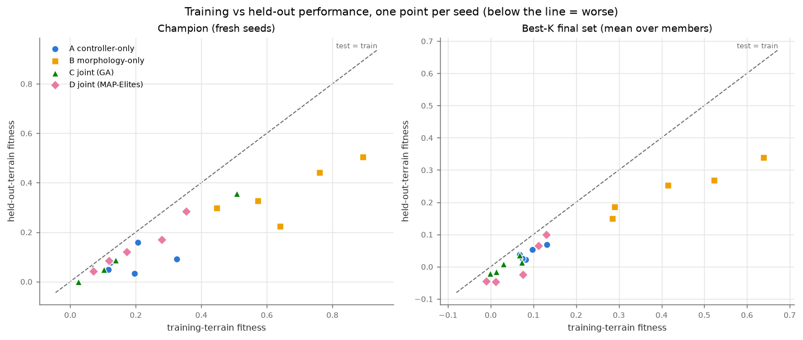
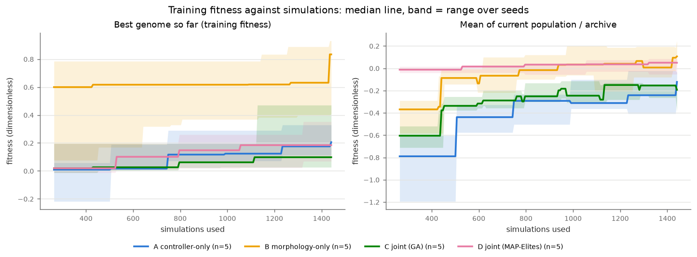
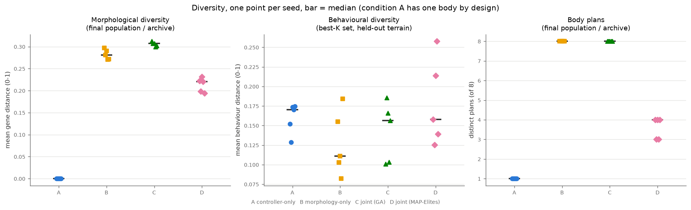
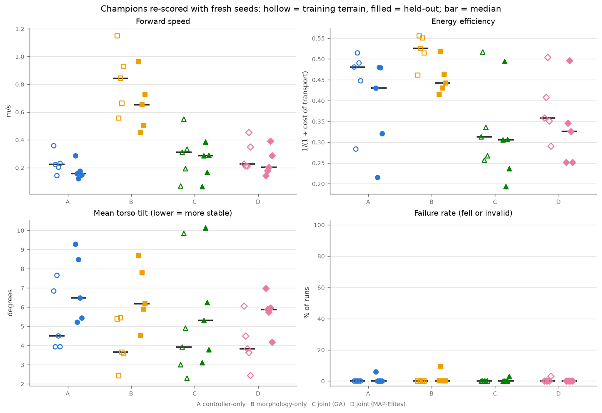
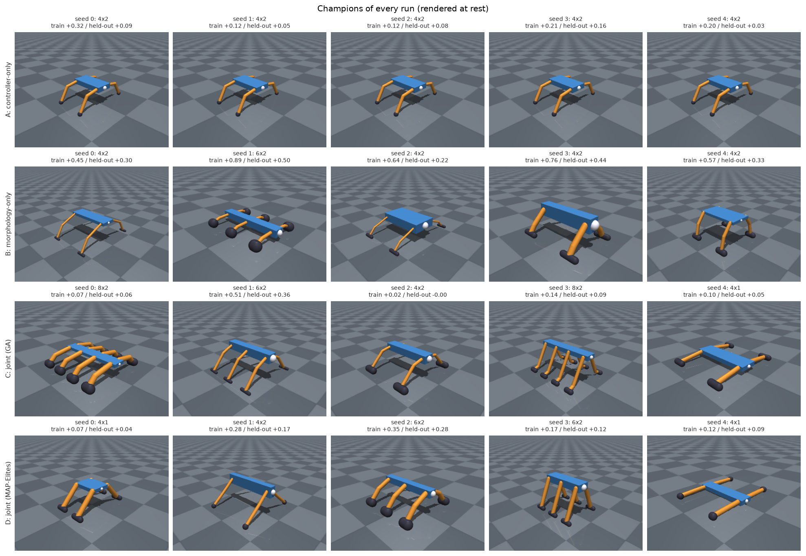

# Results of the comparison experiment

**Short answer: the hypothesis is not shown.** Joint evolution of body and
gait (condition C) did not beat controller-only evolution (A) or
morphology-only evolution (B) on robustness or on behavioural diversity, and
with 5 seeds per condition and only 131 genomes (6 to 9 generations) per run the
experiment could not have shown a small effect. The best held-out champions
came from **B, morphology-only**, which is also the only condition that
started from a hand-designed gait. This page says exactly what was run, what
the numbers are, and what they do and do not support.

All numbers below are from one finished experiment, made on 2026-11-13 and
committed in [`docs/results/comparison/`](results/comparison/). Nothing was
tuned after seeing a result: the design, the statistics and the primary
measures were fixed before the run ([EXPERIMENT.md](EXPERIMENT.md)).

## Question and design

> Does evolving morphology and controller together give more robust and more
> behaviourally diverse locomotion than evolving a controller for a fixed body?

| | condition | algorithm | what evolves | fixed |
|---|---|---|---|---|
| A | controller-only | GA | controller genes | reference quadruped body |
| B | morphology-only | GA | body genes | the reference quadruped's own hand-designed gait |
| C | joint | GA | all genes | nothing |
| D | joint, MAP-Elites | MAP-Elites | all genes | nothing |

* **Seeds:** 5 per condition (search seeds 0-4), 20 runs.
* **Equal budget, counted in simulations:** 1441 simulations per run = 131
  genomes x 11 training environments (population 24; 6 generations in A and D, 8-9 in B and C, because B and C carry protected individuals that are not re-evaluated each generation).
  Every run spent exactly 1441.
* **Training suite** `train` (11 environments), **held-out suite** `test` (11
  other environments, unseen terrain seeds). Champions are re-scored with 3
  fresh spawn seeds per environment (1000-1002 on train, 2000-2002 on test);
  the best-10 final set with 1 fresh seed ([EXPERIMENT.md](EXPERIMENT.md)).
* **Primary measures** (fixed in advance): champion fitness on held-out
  terrain (robustness) and behavioural diversity of the best-10 set on
  held-out terrain. Six primary tests (C vs A, C vs B, D vs C on each),
  Mann-Whitney U, Holm-corrected. The hypothesis counts as supported only if
  C beats both A and B on both measures with Holm p < 0.05.
* **Commit and versions.** Runs were made with `4b61992`
  (`manifest.json` `versions.git_commit`), MuJoCo 4.0.1, Python 3.12.13,
  macOS arm64. Design hash `9ae4752f2ef32431`. Committed analysis and docs
  were produced at the commit this page is part of (`git log docs/RESULTS.md`).

Commands (config `configs/comparison.yaml`, in three sessions because the
command is resumable):

```bash
.venv/bin/python -m evomorph experiment --type comparison --config configs/comparison.yaml
.venv/bin/python -m evomorph experiment --type comparison --config configs/comparison.yaml --workers 4   # x2, resumed
.venv/bin/python -m evomorph analyze --run results/experiments/comparison
```

Search wall time summed over the 20 runs: 5041 s (5.72 simulations/s); 97.7
minutes of timed run time in total, on a laptop that was shared with other work.

## Was the data made by one version of the code? (validity check)

The 20 runs came from three sessions (started 08:30, 12:16 and 18:36 local
time, 2026-11-13), and `manifest.json` records the git commit only once, when
the experiment folder was created (`4b61992`), while `main` has since moved on
(`91c299f`). Before using the numbers I checked that the sessions can be
compared.

| check | result |
|---|---|
| Design/config of every run | The experiment refuses to resume under a different design, and checks each run's `config.yaml` against the design. I also compared the 20 `config.yaml` files by hand: within each condition they are identical apart from `seed` and `workers`. Design hash `9ae4752f2ef32431` in the manifest. |
| Code differences, `git diff 4b61992 91c299f -- evomorph/ configs/` | Two files only, both dashboard presentation code (`visualization/dashboard_media.py`, `visualization/dashboard_page_creature.py`). Nothing in `simulation/`, `evolution/`, `experiments/`, `morphology/`, `controllers/` or `configs/` changed. The later commits (`4537d4d` ... `91c299f`) otherwise touch CI, the licence, the README, `scripts/make_media.py`, tests and dashboard docs. |
| Re-simulation with today's code | `posthoc_evaluate` was re-run on all 20 runs with the code at `91c299f` (without writing) and compared with the stored `posthoc.json`: see the result line below. |
| Interrupted runs | `results/experiments/comparison/incomplete/` holds `morphology_s1-1` and `morphology_s3-1`, searches that were interrupted and redone. They are not in `runs/`, not in `manifest.json` and not in any table. |

**Result: 20 of 20 runs re-evaluated to a byte-identical record** (the whole
`posthoc.json` content: champion and best-10 set scores on both suites,
diversity and failure rates, compared as JSON; zero differences, champion
held-out fitness difference exactly 0.0 in every run). Command, run from the
repository root at `91c299f` (a first version of the script that is now
`scripts/recheck_posthoc.py`):

```bash
.venv/bin/python scripts/recheck_posthoc.py results/experiments/comparison --workers 4
```

Output: 20 lines `IDENTICAL`, 0 `DIFFERENT`. So the evaluation code of the three sessions
and today's code produce the same numbers, and no run had to be redone. The
experiment's own consistency checks and the config comparison cover the
search side; the search itself (the only part that this re-run does not repeat)
is covered by the empty code diff above.

One honest limit: the per-run code version was not recorded, so the claim
"same code for every run" rests on the diff above plus the identical
re-simulation, not on a stamp. Recording the commit per run is not done.

## Headline numbers

Medians over the 5 seeds with a bootstrap 95% interval (with 5 seeds that is
little more than the range). Fitness is dimensionless; about 1 means clean
walking at 0.2 m/s. Full table: [`summary.md`](results/comparison/summary.md),
every run: [`results.csv`](results/comparison/results.csv), tests:
[`stats.csv`](results/comparison/stats.csv).

| measure | A controller-only | B morphology-only | C joint (GA) | D joint (MAP-Elites) |
|---|---|---|---|---|
| **champion fitness, held-out** (primary) | 0.078 [0.034, 0.158] | **0.327** [0.223, 0.505] | 0.058 [-0.000, 0.356] | 0.120 [0.041, 0.284] |
| champion fitness, training (fresh seeds) | 0.196 [0.116, 0.324] | 0.640 [0.447, 0.892] | 0.103 [0.024, 0.507] | 0.172 [0.071, 0.353] |
| champion gap, held-out minus training | -0.069 | -0.320 | -0.052 | -0.052 |
| best-10 set mean fitness, held-out | 0.037 | 0.253 | 0.008 | -0.024 |
| champion speed, held-out (m/s) | 0.157 | 0.653 | 0.288 | 0.203 |
| champion failure rate, held-out | 0 | 0 | 0 | 0 |
| **behavioural diversity, best-10 set, held-out** (primary) | 0.170 | 0.111 | 0.157 | 0.158 |
| morphological diversity, final population | 0 (one body by design) | 0.281 | 0.308 | 0.221 |
| body plans in the final population (see note) | 1 | 8 | 8 | 4 |

Note on the last row: it is not a finding. The selection rule protects the best individual of every body plan (`plan_elites: 1`), so B and C hold all 8 plans by construction once each has appeared, A has 1 because its body is frozen, and D has no such rule.

For scale: the hand-designed reference quadruped scores 0.371 on the training
suite and 0.173 on the held-out suite when re-scored on the champions' own
fresh seeds (1000-1002, 2000-2002; `evaluate_suite`, 66 simulations, no search).
([TERRAINS.md](TERRAINS.md) gives 0.357 / 0.181 on other seeds; an earlier
draft of this page used those, which are not the champions' seeds. No count
below changes.) Held-out champions at or above 0.173: **A 0 of 5, B 5 of 5, C 1 of 5, D 1 of 5.** Most
evolved champions in A, C and D are therefore *worse than the creature the
experiment started from*: 131 genomes is very little evolution.

### The six primary tests

| measure | comparison | medians | A12 (P first better) | p | Holm p |
|---|---|---|---|---|---|
| champion fitness, held-out | C vs A | 0.058 vs 0.078 | 0.48 | 1 | 1 |
| champion fitness, held-out | C vs B | 0.058 vs 0.327 | 0.12 | 0.056 | 0.33 |
| champion fitness, held-out | D vs C | 0.120 vs 0.058 | 0.64 | 0.55 | 1 |
| behavioural diversity, held-out | C vs A | 0.157 vs 0.170 | 0.36 | 0.55 | 1 |
| behavioural diversity, held-out | C vs B | 0.157 vs 0.111 | 0.64 | 0.55 | 1 |
| behavioural diversity, held-out | D vs C | 0.158 vs 0.157 | 0.68 | 0.42 | 1 |

No primary comparison is significant after correction. The computed verdict is
**NOT SHOWN**. On robustness C is, if anything, behind A and clearly behind B
(C beats a B run in 12% of seed pairings; raw p = 0.056). On behavioural
diversity C leans ahead of B and behind A, with effects of medium size that
5 seeds cannot separate from noise. With 5 vs 5 seeds the smallest possible
two-sided p is 0.0079, and 0.0476 after Holm over six tests, so only
near-complete separation could ever have been called significant.

### Per-seed champions (held-out fitness)

| seed | A | B | C | D |
|---|---|---|---|---|
| 0 | +0.091 (4x2) | +0.298 (4x2) | +0.058 (8x2) | +0.041 (4x1) |
| 1 | +0.048 (4x2) | +0.505 (6x2) | +0.356 (6x2) | +0.171 (4x2) |
| 2 | +0.078 (4x2) | +0.223 (4x2) | -0.000 (4x2) | +0.284 (6x2) |
| 3 | +0.158 (4x2) | +0.442 (4x2) | +0.086 (8x2) | +0.120 (6x2) |
| 4 | +0.034 (4x2) | +0.327 (4x2) | +0.049 (4x1) | +0.086 (4x1) |

(Plan `NxM` = N limbs, M segments per limb.) Seed 1 of C (a six-legged
metachronal walker, 0.356 held-out) is the best joint-evolution champion and is
below the second-best B champion (0.442) and above the weakest (0.223); the spread between seeds inside a
condition is as large as the spread between conditions for A, C and D.

### Figures

Main figure: training against held-out fitness, one point per seed. Everything
below the dashed line is worse on unseen terrain; B sits higher on both axes
but also falls furthest below the line (its gap is -0.32).



| | |
|---|---|
|  |  |
| Best training fitness so far against simulations used (median, band = range over seeds). B starts near 0.6 because its fixed gait is the reference gait; A, C and D start near 0. | Morphological diversity, behavioural diversity and body plans per seed. |
|  |  |
| Speed, efficiency, tilt and failures of the champions. | The 20 champions at rest. |

Also in `docs/results/comparison/plots/`: `body_plans.png`,
`archive_heatmap.png`.

## What the evidence says, and what it does not

**What the data supports (descriptive; none of the between-condition differences below is significant after Holm correction)**

* B, the condition that evolves the body around a fixed, good gait, produced
  the best held-out champions at this budget: median 0.327, every seed above
  the reference quadruped's 0.173. Its advantage over C is large in effect size
  (A12 0.12, B better) but not significant after Holm correction (0.33).
* Champions rarely fell on held-out terrain: the median failure rate is 0 in
  all four conditions (A0 fell in 2 of 33 runs, B1 in 3, C4 in 1; no other
  champion fell).
* The generalisation gap is negative everywhere: every condition's champions
  do worse on unseen terrain than on fresh seeds of the training terrain, and
  the winner's curse (selected vs fresh training fitness) is small except for
  B seed 2 (0.889 selected, 0.640 fresh) and B seed 3 (0.834, 0.761).
* Body-plan counts reflect the design, not a result: A has one body, B and C
  hold all 8 plans because the selection rule protects one individual per
  plan, and MAP-Elites keeps 3-4 (its archive holds only creatures that did not
  fall, and 10-21 of its 100 cells filled).

**Not shown, and the reasons it may be a limit of this experiment rather than
a property of the idea**

* **The hypothesis.** No evidence that joint evolution is more robust or more
  diverse. Also no evidence for the opposite: a non-significant result is not
  evidence of equality.
* **The search is far too short.** 131 genomes, 6 to 9 generations. In
  `docs/EVOLUTION.md` a single flat-ground GA run (3 simulations per genome,
  6000 simulations = 2000 genomes, 51 generations of 48) found its best walker
  only near the end: 4.2 times this budget in simulations and about 15 times
  in genomes. Joint search spaces are bigger than
  controller-only or morphology-only spaces, so a fixed small budget is
  structurally unkind to C and D. Conditions A, C and D are largely still
  at the "random creature" stage (their generation-0 best is near 0 on the
  left of the fitness figure).
* **B is a strong baseline with a head start; the comparison is not
  symmetric.** B does not search for a gait; every B genome is driven by the
  hand-designed one (the reference quadruped's own gait, which scores about
  0.37 on training terrain on its own body). B's generation 0 is 24 *random
  bodies* with that gait, not the reference body, and its best training
  fitness there is already 0.076, 0.618, 0.599, 0.785, 0.318 (seeds 0-4); A's
  is 0.030, 0.058, 0.009, 0.007, -0.218 and C's 0.019, 0.196, 0.013, -0.012,
  0.062 (D's generation 0 is identical to C's, same random draws). B then
  improves by only +0.05 to +0.33 (final 0.409, 0.931, 0.889, 0.834, 0.530),
  so most of its lead over A, C and D is present before any search. A, with the
  reference body but a random controller, does not get anywhere near the
  hand-designed gait in 131 genomes (fresh-train median 0.196 against the
  reference's 0.371). The result says "with 131 genomes, evolving bodies around
  a good gait beats searching for a gait", not "evolving morphology alone is
  better than evolving jointly". The earlier "mirror images" framing in
  `docs/EXPERIMENT.md` and `baselines.py` was wrong and has been corrected. No
  control (for example A seeded with the reference gait) was run.
* **5 seeds.** Only near-complete separation can be significant, and the
  interval of every median is wide.
* **Unpaired tests**, and a behaviour space (six descriptors and their ranges)
  that was a choice. A different choice could rank diversity differently.
* **Behavioural diversity is measured on the best-10 sets**, which for C and D
  have a mean held-out fitness near zero. A high value there can come from
  erratic gaits as much as from distinct strategies (interpretation, not
  tested), so it does not mean "more interesting creatures". The per-seed
  values range from 0.08 to 0.26 and overlap across all four conditions.

## Champion exploit check

The fitness is multiplicative and charges foot slip, airborne time, torso tilt
and lateral drift, but the core's own notes say fast gaits still skate
([TERRAINS.md](TERRAINS.md), [EXPERIMENT.md](EXPERIMENT.md)). So every one of
the 20 champions was checked.

How: each champion genome was re-simulated offscreen
(`scripts/make_media.py audit`, flat ground, spawn seed 0, 10 s, 6 frames per
creature at 320x240) and I looked at all four sheets, one per condition; the
exploit metrics (foot support, slip, airborne fraction, height gain, lateral
deviation) were read from that run and from the 33 held-out runs of each
champion stored in `posthoc.json`. Flags use thresholds I chose after seeing
the numbers, so they are reading aids, not a pre-registered test, and they
changed no score: **airborne** = mean airborne fraction on held-out terrain
above 0.20, **lateral** = more than 2 m of sideways deviation in 10 s on flat
ground, **height** = body gained more than 0.10 m, **support** = foot support
below 0.9.

| run | champion | plan | held-out fitness | held-out mean slip | held-out mean airborne (max env) | flat: foot support | flat: height gain m | flat: lateral dev m | flag |
|---|---|---|---|---|---|---|---|---|---|
| A0 | g0004-018 | 4x2 | +0.091 | 0.65 | 0.014 (0.029) | 1.00 | 0.02 | 0.33 | - |
| A1 | g0004-001 | 4x2 | +0.048 | 0.89 | 0.108 (0.135) | 1.00 | 0.01 | 0.33 | - |
| A2 | g0003-010 | 4x2 | +0.078 | 0.34 | 0.001 (0.003) | 1.00 | 0.03 | 0.14 | - |
| A3 | g0005-013 | 4x2 | +0.158 | 0.61 | 0.002 (0.008) | 1.00 | 0.02 | 0.17 | - |
| A4 | g0004-005 | 4x2 | +0.034 | 0.71 | 0.031 (0.049) | 1.00 | 0.01 | 0.90 | - |
| B0 | g0007-006 | 4x2 | +0.298 | 0.91 | 0.311 (0.364) | 1.00 | 0.06 | 3.53 | airborne, lateral |
| B1 | g0007-003 | 6x2 | +0.505 | 0.67 | 0.040 (0.065) | 1.00 | 0.03 | 0.03 | - |
| B2 | g0006-012 | 4x2 | +0.223 | 0.88 | 0.089 (0.136) | 1.00 | 0.05 | 0.82 | - |
| B3 | g0005-012 | 4x2 | +0.442 | 0.81 | 0.129 (0.233) | 1.00 | 0.02 | 0.07 | - |
| B4 | g0004-003 | 4x2 | +0.327 | 0.86 | 0.225 (0.345) | 1.00 | 0.01 | 0.83 | airborne |
| C0 | g0007-000 | 8x2 | +0.058 | 0.46 | 0.001 (0.003) | 1.00 | 0.02 | 0.10 | - |
| C1 | g0005-005 | 6x2 | +0.356 | 0.44 | 0.002 (0.013) | 1.00 | 0.03 | 0.14 | - |
| C2 | g0001-012 | 4x2 | -0.000 | 0.91 | 0.465 (0.554) | 1.00 | 0.11 | 1.24 | airborne, height |
| C3 | g0003-014 | 8x2 | +0.086 | 0.64 | 0.008 (0.017) | 0.99 | 0.03 | 0.22 | - |
| C4 | g0005-013 | 4x1 | +0.049 | 0.91 | 0.205 (0.293) | 1.00 | 0.01 | 0.47 | airborne |
| D0 | b0004-016 | 4x1 | +0.041 | 0.79 | 0.092 (0.136) | 1.00 | 0.01 | 0.69 | - |
| D1 | b0005-001 | 4x2 | +0.171 | 0.54 | 0.004 (0.016) | 1.00 | 0.03 | 0.08 | - |
| D2 | b0004-011 | 6x2 | +0.284 | 0.34 | 0.001 (0.006) | 1.00 | 0.02 | 0.08 | - |
| D3 | b0003-005 | 6x2 | +0.120 | 0.79 | 0.043 (0.100) | 1.00 | 0.03 | 3.02 | lateral |
| D4 | b0004-021 | 4x1 | +0.086 | 0.86 | 0.168 (0.244) | 1.00 | 0.01 | 0.29 | - |

What the frames show (sheets rendered from the saved genomes on 2026-11-13,
`scripts/make_media.py audit`, offscreen; not committed, the table above is the record):

* **No champion cheats in the sense of flying, tunnelling or standing on
  non-foot parts.** Foot support is 1.00 (0.99 once) for all 20; max height
  gain is at most 0.11 m; every creature is on the ground, upright and
  lit in all six frames. The engine's launch, tunnelling and speed guards
  rejected nothing here (no invalid runs among the 660 held-out re-scores of
  champions).
* **A: clean.** No flags. Slow, upright 4x2 walkers; A1 slips a lot (0.89 of
  loaded stance on held-out terrain) and is airborne 11% of the time.
* **B: two champions bound and skate.** B0 (airborne 31% of the time, 3.5 m
  sideways drift on flat ground, slip 0.91, covers 11.5 m in 10 s) and B4
  (airborne 22%, 9.7 m in 10 s) are bouncing, skidding gaits. In the frames
  both keep a level torso and move their feet in a trot, but the creature
  leaves the ground between steps. B2 and B3 are fast too (9.7 m and 7.5 m in
  10 s) with 9-13% airborne and slip 0.81-0.88. **Only B1** (a 6x2 with round
  feet, 6% airborne on flat ground, 0.03 m drift) looks like a clean walker. B's speed
  advantage (0.65 m/s against 0.16-0.29) is therefore partly bounding and
  skating, which the fitness charges but does not forbid.
* **C: one clear exploit, one borderline.** C2 (`g0001-012`, held-out
  fitness -0.000) is airborne 46% of the time and gains 0.11 m of height: a
  hopper that the multiplicative fitness correctly scores at about zero. C4 is
  airborne 21% with slip 0.91. C0, C1, C3 are clean walkers (airborne below
  2%); C1 is the best joint champion and slips only 0.44.
* **D: no airborne exploit; one wanderer.** D3 (`b0003-005`) is a six-legged
  walker that drifts 3.0 m sideways while covering 4.2 m (the lateral-drift
  factor should charge that; its held-out fitness is 0.12). D2 is among the cleanest
  creatures of the experiment: slip 0.34, airborne 0.1%, 0.08 m drift.
* **Slip is universal.** Mean slip fraction on held-out terrain is 0.34-0.91
  for every one of the 20 champions: all of them slide while loaded. This is the
  known skating weakness of the core, not a property of one condition.
  Faster champions skate more (Spearman rho +0.56 between slip and speed
  across the 20 champions, p 0.011, recomputed here from the 20 champions' posthoc records; slip against fitness -0.20,
  p 0.40), and the slip factor `1 - 0.5 x slip` can cost at most half the
  score.

Effect on the headline: before dropping anyone the held-out medians rank B 0.327
> D 0.120 > A 0.078 > C 0.058. Dropping every flagged champion (B0, B4, C2, C4
for airborne; D3 also for lateral drift) gives A 0.078 (none flagged), B 0.442
(B1, B2, B3), C 0.086 (C0, C1, C3) and D 0.129 (D0, D1, D2, D4), i.e. B > D > C
> A. **B stays first and D second; A and C swap places** (0.078 against 0.086).
An earlier draft said the ordering did not change; that was wrong. The swap
does not touch the primary conclusion: the A-C gap is 0.008 on a spread of
0.03-0.36 per condition, and a Mann-Whitney test of C (3 unflagged) against A
(all 5) gives p = 0.57 (unadjusted, descriptive, run after seeing the data),
while C against B (3 unflagged) gives p = 0.20. C beats neither A nor B with or
without the flagged champions, so "not shown" stands, and the flagged champions
are a caveat on B's speed rather than a reason to discard the comparison.

## Limits of the held-out suite: grip is not tested

The held-out suite varies slope, roughness, obstacles and friction, but it does
not measure traction robustness, and the skating question was not answered.
The design rationale for the friction 0.2 environment (`suites.py`, earlier
draft) was that a gait that skates should break down on ice. The data say the
opposite for these champions: the mean fitness of the 20 champions on
`friction_mu0.2` is 0.231, above their all-held-out mean of 0.173, and 12 of
the 20 score higher on mu 0.2 than on the held-out average (B4 runs 0.99 m/s
there against 0.73 m/s overall, at slip 0.97). Slip is not penalised much
(factor at most 0.5) and faster gaits slide more (rho +0.56 with speed). So
"robustness" here means robustness to slope, roughness and clutter. Foot slide
is real contact physics in every condition (the references skate too) and foot
support is 1.00 for every champion, so the cross-condition comparison is not
invalidated, but whether low friction makes skaters lose, which
[TERRAINS.md](TERRAINS.md) deferred to this experiment, is not answered by it.
The suites and scores were not changed.

## What was not done

* No test of grip robustness (see above); no re-run with a suite where skating is penalised.
* No run longer than 131 genomes. The experiment document recommends an
  overnight run (482 genomes per run) as the one to trust more; it was not
  made.
* No paired design, no more than 5 seeds, no condition that evolves the
  controller on B's frozen body with the *same* head start for the others
  (for example A seeded with the reference gait). That would separate "head
  start" from "morphology search".
* The exploit thresholds are post hoc reading aids. Slip is reported but the
  fitness was not redesigned.
* Only the committed champions' genomes, configs, per-generation `metrics.csv`
  and the combined tables are in the repository. The raw per-generation
  records, archives and `posthoc.json` files (23 MB) stay out of git
  (`results/` is ignored); to regenerate them, run the commands above. The runs
  are deterministic within one MuJoCo version on one CPU architecture, so a
  regenerated experiment on the same setup reproduces the numbers here; on
  another architecture the last bits can differ
  ([DASHBOARD.md](DASHBOARD.md)).

## Where everything is

| what | where |
|---|---|
| experiment manifest | `docs/results/comparison/manifest.json` |
| design | `docs/results/comparison/experiment.yaml` |
| per-run table, tests, summary | `results.csv`, `stats.csv`, `summary.md` in the same folder |
| plots | `docs/results/comparison/plots/` |
| champion genomes | `docs/results/comparison/runs/<condition>_s<seed>/best_genome.json` (selected on training) and `best_heldout.json` (its held-out record) |
| per-run config and learning curve | `config.yaml`, `metrics.csv` in each run folder |
| media (clip, elite grid, stills) | `docs/media/results/`, described in its `NOTES.md` |
